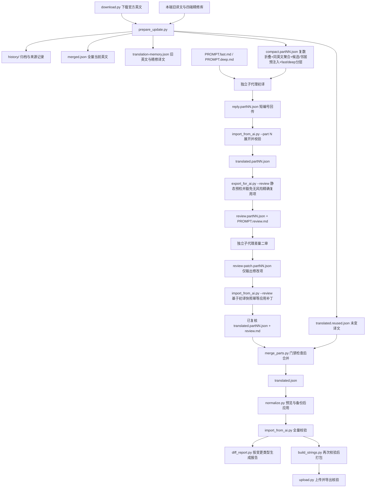

# 01 · 架构与设计原则

## 质量与职责

当前官方英文决定语义，功能上下文帮助消除歧义，共用术语表约束表达。本地脚本负责复数折叠、同英文聚合、跨端精修候选匹配、同模块上下文预注入、静态预检、结构校验与打包；翻译 AI 在独立干净的子会话中依据预注入上下文核对复用或完成翻译，再通过差量二审单独复核语义与一致性，遵循 [审校规范](06-translation-style.md)。

官方简中和社区包以解析后的 JSON 保留在本地，仅在预注入上下文仍无法消解具体疑点时按 key 定向查阅。参考译文可能有误，功能判断优先依据界面、同功能文案和官方客户端源码。

当前四端精修主文件共同构成项目的翻译记忆。英文未变时默认复用已通过结构校验的译文；新增或变更词条导出时，脚本自动按精确英文、占位符安全双射投影与大小写不敏感匹配检索四端精修候选，并校验占位符兼容性。发现语义错误、上下文变化或术语冲突时定向审校。模型升级后仍执行相同质量标准，按实际问题决定修订范围。

## 增量数据流

## 关键约束

- 以旧 `merged.json` 和对应 `translated.json` 比较新英文。同 key 英文变化必须审校；新一轮仅需下载官方英文。
- 更新前归档现有 raw、parsed、work 文件和 dist；任务结束后按 [下载资源清理规则](../AGENTS.md#维护铁律) 删除下载原件及归档中的复制件。英文基准与参考数据以解析后的 JSON 保留。
- **脚本预处理与职责边界**：
  - 同词根且占位符签名与变更状态一致的复数分支合并为 1 条导出，共享同一英文的多个 key 自动聚合审阅（支持按 key 覆写语境差异），回传后自动展开回全部原始 key 并逐 key 校验占位符。
  - 原文变化（`changed`）条目同时携带旧英文 `p_en` 与上一轮精修中文 `p_zh`。
  - 跨平台候选匹配支持精确英文、占位符严格双射安全投影（禁止静默参数换序，且投影结果须通过目标占位符门禁）与大小写不敏感提示（标记 `[ci|...]`）。
  - 分片头部按功能前缀去重附带本平台已译邻居（`context`），脚本展开与路由元数据独立写入 `.meta.json`，确保 AI 输入聚焦于语义判断。
- **复杂度分层与可回滚差量二审**：
  - 按词条复杂度切分为常规片（`fast`，默认上限 350 组，配精简任务头）与疑难片（`deep`，默认上限 120 组，配完整审校合约）；总组数不超过 `deep` 上限时合并为单片处理。
  - 每个分片由独立干净的子代理处理，保持上下文清晰、避免跨分片干扰；宿主不支持调节思考档位时，全程使用选定的同一主力模型即可。
  - 二审导出前留存不可变初译快照 `translated-draft.partNN.json`，并对术语、称呼/省略号、首尾空白、长度比例及本端同英文多译差异执行静态预检（附 `flags` 置顶提示）。常规片中精确采用四端候选且无预检提示的词条免除二审；其余词条进入 `review.partNN.json`（默认上限 350 组），二审仅输出需要修改的编号补丁（整片无修改输出 `{}`）。补丁始终基于初译快照幂等重放，删改补丁可完整回退；合并前由 `merge_parts.py` 强制核对二审完成状态与文件时效。
- `translated.json` 是合并后规范化、人工修订与打包的唯一主文件。分片保留审校交付记录；合并后修改主文件，不重新合并旧片。
- 结构、key 覆盖和占位符校验通过，才能合并与打包。机器校验之外的语义复核范围与疑点处理记录在 `review.md`。
- Android、iOS、TDesktop 和 macOS 原生客户端各自维护 key 集合，共用术语表，单平台串行更新时前序平台的新译文自动进入后续平台候选池。

## 平台资源格式

Android 使用 translations.telegram.org 导出的 `<resources><string name="key">…</string></resources>` XML；复数以 `_zero`、`_one`、`_two`、`_few`、`_many`、`_other` 后缀展开。其他三个平台使用 `.strings`。平台资源统一解析为现有 JSON 字段，打包时按平台恢复格式。
